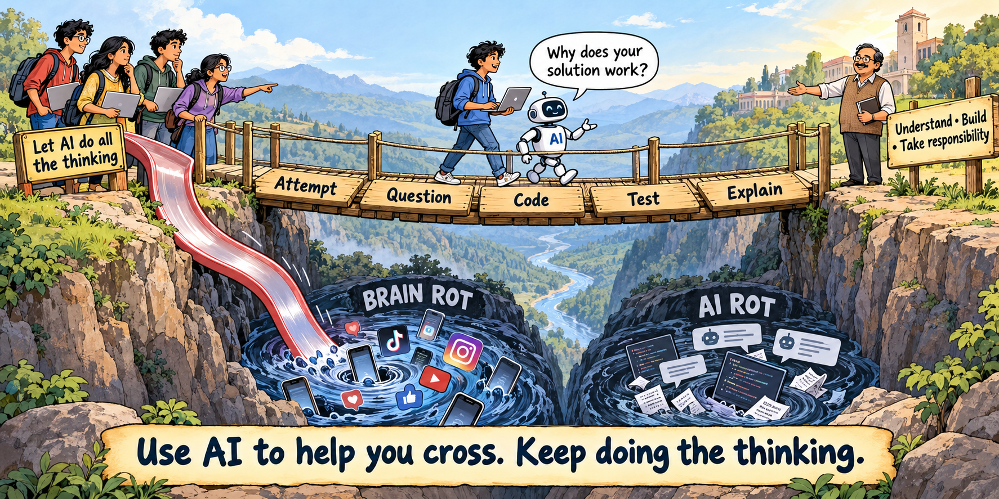

# W15: Holiday Week {.unnumbered}

**Dates:** Mon Nov 9 & Tue Nov 10, 2026 · 8:00–8:50 am · 12LH3004

::: {.callout-important}
No classes — Govardhan Puja (Mon Nov 9) and Declared Holiday (Tue Nov 10).
:::

## PAGAL Notes

*PAGAL — Perspectives on Algorithms, Generative AI & Learning: the week's informal column.*

**The model can write the code. You own what ships.**

{#fig-ai-bridge fig-alt="Students cross a bridge labelled Attempt, Question, Code, Test and Explain, with an AI companion asking why their solution works. A professor waits on the far bank. A shortcut labelled Let AI do all the thinking leads into a valley labelled Brain Rot and AI Rot."}

Two videos for the holiday week:

- [Miles Cranmer — **How to Avoid AI Brain Rot**](https://www.youtube.com/watch?v=uXC7OuCas2Q&t=1s)
- [Jascha Sohl-Dickstein — **Advice for a young investigator** (2026 Conference on Physics and AI)](https://www.youtube.com/watch?v=3LZN2UUxDos)

Watch them with this question in mind: **as AI does more of the execution, how will
I develop the judgement to direct it?**

Even if models write most of a program, the human owns its purpose, specification,
tests and consequences. Treat a coding model like an eager graduate whose judgement
needs supervision. You decide what to build, which assumptions are acceptable, and
what evidence justifies shipping it.

That takes **taste**: recognising a useful problem, a clear specification, a simple
design and a convincing test. As a young undergraduate, you develop it by writing,
reading, tracing and debugging code. Debugging a wrong loop bound or dangling pointer builds the experience you need to
challenge generated code and take responsibility for it.

There is a double edge here. In [**Your Brain on ChatGPT**](https://arxiv.org/abs/2506.08872),
Kosmyna and colleagues studied 54 participants writing essays. The LLM group showed
weaker EEG connectivity, more difficulty quoting their own essays, and lower reported
ownership. These findings suggest risks to engagement and recall; this small preprint
on essay writing does not establish the same effects in coding or permanent cognitive
harm. Still, it is a reason to ask: **am I practising the skill, or only accepting an
output?**

AI can help you learn coding, or any other skill, through **active, Socratic practice**.
Try this prompt on a lab problem:

> Let me attempt it first. Ask one question at a time. Challenge my assumptions and
> ask me to predict the result. Give a small hint when I am stuck. Ask me for a
> counterexample and a test before showing a solution.

Debate the answer. Challenge the model too: it can be wrong. Run the tests, explain
why a proposed fix works, then close the chat and solve a small variation yourself.
The useful measure of the session is what you can now understand, judge and do.
